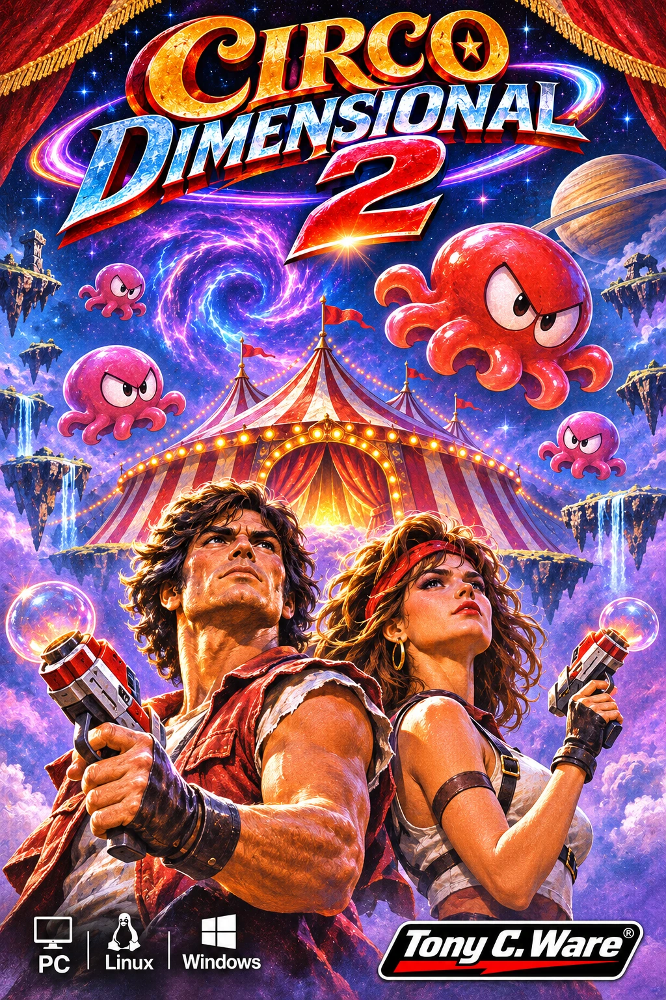

# CIRCO DIMENSIONAL 2

<p align="center"></p>

**Edición de publicación v1.0.0 · © 2026 Tony C. Ware · Python / Pygame · Linux / Windows**

> Dom se deshizo de los malditos pulpos en su anterior aventura en 48K, pero los pulpos han vuelto. El circo ahora flota por la galaxia y viaja hacia Saturno. Dom tiene un látigo láser. A veces, dos.

**La historia original íntegra**, escrita por el autor, está en [HISTORIA_ORIGINAL.txt](HISTORIA_ORIGINAL.txt). Esta edición conserva la jugabilidad de la **v0.3.7**; el cambio a 1.0.0 corresponde a la publicación definitiva y a la documentación.

## Descargar el juego listo para ejecutar

**Edición definitiva v1.0.0 — no necesita instalar Python ni Pygame.** Los ejecutables autónomos se generan en GitHub Actions a partir del código de la etiqueta `v1.0.0`.

- **Linux x86_64 (AppImage):** [Descargar Circo_Dimensional_2_v1.0.0_x86_64.AppImage](https://github.com/OnRail76/Circo-Dimensional-2/releases/download/v1.0.0/Circo_Dimensional_2_v1.0.0_x86_64.AppImage). Descarga, marca como ejecutable y abre el juego. En distribuciones sin FUSE prueba `APPIMAGE_EXTRACT_AND_RUN=1 ./Circo_Dimensional_2_v1.0.0_x86_64.AppImage`.
- **Windows x64 (EXE):** [Descargar Circo_Dimensional_2_v1.0.0_Windows_x64.exe](https://github.com/OnRail76/Circo-Dimensional-2/releases/download/v1.0.0/Circo_Dimensional_2_v1.0.0_Windows_x64.exe). Descarga y ejecuta el archivo.
- [**Release v1.0.0**](https://github.com/OnRail76/Circo-Dimensional-2/releases/tag/v1.0.0): también incluye el ZIP con fuentes, manual ilustrado, atlas corregido y carátula.

La compilación automática y las comprobaciones de estructura han terminado correctamente en GitHub Actions. Todavía se recomienda probar una partida completa en cada sistema.

## El juego

Arcade de pantalla fija inspirado en la mecánica de división de enemigos de *Pang*, pero con identidad, personajes, gráficos y música propios. Dom debe eliminar pulpos saltarines con su látigo láser. Los pulpos grandes se dividen hasta desaparecer. **25 fases** repartidas entre La Carpa Errante, El Circo Invertido, Jardines de Saturno, El Teatro Fantasma y Corazón Dimensional. La fase 25 incorpora al Pulpo Primordial.

- Dos modelos de pulpo PNG aprobados por el autor (sonriente y bandana), **25 paletas cromáticas** y animación de salto; el bandana resiste dos golpes, el Primordial cuatro.
- Cinco **fondos HD oficiales** ilustrados, suelo bajo Dom, plataformas luminosas, estrellas y portales de energía animados.
- **Ocho pistas OGG originales** y nueve efectos WAV, incluidos en el repositorio.
- Dom con 3 vidas iniciales, smileys amarillos de VIDAS, explosión cómica al morir y **2 s de invulnerabilidad** al reaparecer.
- Bonus: **doble látigo durante 10 s**, escudo 8 s, +15 s al reloj o vida extra. Los efectos temporales no se trasladan a la siguiente fase. Máximo 1 ítem en fases 1-5 y 2 desde la 6; no se genera uno inútil al matar al último enemigo.
- Menús con cabeza animada de Dom y pulpito rebotador; configuración persistente de música, efectos y volumen; mandos USB/Bluetooth detectados por SDL.
- GAME OVER y VICTORIA con **al menos 3 s** de permanencia antes de volver al título.

## Descarga y ejecución desde fuentes

### Linux (Bazzite, Fedora y distribuciones compatibles)

```bash
bash iniciar_linux.sh
```

El primer arranque crea un `.venv` local e instala **pygame-ce==2.5.8** desde paquetes binarios. Hace falta Python 3 compatible, `venv` y conexión para la primera instalación; después funciona sin conexión. Si quieres crear un ejecutable AppImage:

```bash
bash CREAR_APPIMAGE_LINUX.sh
```

**El archivo ZIP de fuentes no contiene el AppImage; está disponible en la Release oficial.** El script genera `dist/Circo_Dimensional_2_v1.0.0_x86_64.AppImage` cuando se ejecuta correctamente en Linux x86_64. Para sistemas sin FUSE, puede ayudar `APPIMAGE_EXTRACT_AND_RUN=1`.

### Windows

Ejecuta `iniciar_windows.bat` con Python instalado. Para construir un **EXE autónomo** en Windows usando PyInstaller:

```powershell
powershell -ExecutionPolicy Bypass -File tools/crear_exe_windows.ps1
```

El resultado previsto es `dist/CircoDimensional2.exe`; **el EXE precompilado se descarga desde la Release oficial**. El workflow [portables.yml](.github/workflows/portables.yml) permite compilar binarios para Linux y Windows usando GitHub Actions, una vez publicado el código.

## Controles

| Acción | Teclado | Mando (mapeo según SDL) |
|---|---|---|
| Mover a Dom | `O/P`, `A/D` o flechas | Stick izquierdo o cruceta |
| Látigo láser | `ESPACIO` | Botón principal |
| Aceptar / jugar | `INTRO` o `ESPACIO` | Botón principal |
| Pausar | `ESC` | START / OPTIONS |
| Opciones de menú | Flechas; izquierda/derecha cambia valor | Cruceta / stick |
| Música ON/OFF | `N` | Menú Opciones |
| Silenciar todo | `M` | Menú Opciones |
| Volumen de música | `+ / -` | Menú Opciones |
| Pantalla completa | `F11` | Teclado |

Los controles exactos del mando pueden variar según el fabricante; **no se han ensayado mandos físicos en este entorno**.

## Manual, atlas y material gráfico

- [Manual ilustrado del jugador (PDF)](docs/MANUAL_ILUSTRADO_CIRCO_DIMENSIONAL_2_v1.0.0.pdf)
- [Atlas visual y memoria técnica (PDF)](docs/ATLAS_VISUAL_Y_MEMORIA_CIRCO_DIMENSIONAL_2_v1.0.0.pdf)
- [Muestrario de las 25 fases (PNG)](docs/muestrario_25_fases_sprites.png)
- [Carátula oficial PNG](assets/cover/caratula_oficial.png) / [original WEBP](assets/cover/caratula_original.webp)
- [Historia original](HISTORIA_ORIGINAL.txt)
- [Ilustraciones HD originales enviadas por el autor](docs/originales_hd/) (WEBP; se conservan sin cambios)

**Nota de fidelidad visual:** la documentación usa arte suministrado por el autor, fondos y sprites PNG extraídos del proyecto. No se han creado capturas ficticias de juego; las imágenes de interfaz antigua que puedan aparecer en la memoria se rotulan como históricas. No se ha podido realizar una captura final de juego en ejecución aquí al no disponer de la biblioteca Pygame.

## Fuentes y arquitectura

```text
main.py                     punto de entrada
circo/game.py               estados, interfaz, controles, bonus y partida
circo/physics.py            física, rebotes, colisiones y división
circo/levels.py             25 fases y parámetros
circo/art.py                Dom, sprites procedimentales, HUD, plataformas, FX
circo/backgrounds.py        carga y composición de fondos HD
circo/sprites.py            sprites PNG y fotogramas
circo/stage_colors.py       colores por fase
circo/audio.py              música OGG y efectos WAV
assets/backgrounds/         5 fondos HD aprobados
assets/sprites/             originales y recoloreados de 25 fases
assets/music/               8 pistas OGG
assets/sfx/                 9 WAV
assets/icons/               icono del pulpo normal
assets/cover/               carátula oficial
scripts y tools/            arranque, empaquetado y regeneración
.github/workflows/          tests y ejecutables portátiles
tests/                      pruebas automatizadas
```

## Verificación

```bash
python -m unittest discover -s tests -v
# Opcional si tienes pytest:
python -m pytest -q
```

**65 pruebas de código y recursos superadas en un entorno con Pillow** al preparar la edición. Se han comprobado la integridad de los ZIP/PDF y la sintaxis; no se ha ejecutado una sesión gráfica completa ni compilado el AppImage/EXE en este entorno. Los workflows son procedimientos de compilación, no certificados de funcionamiento en todos los equipos.

## Publicación y mantenimiento

La **[release oficial v1.0.0](https://github.com/OnRail76/Circo-Dimensional-2/releases/tag/v1.0.0)** ya está publicada y contiene el AppImage Linux, EXE Windows, fuentes, carátula, manual y atlas. Los workflows de [pruebas](.github/workflows/tests.yml) y [binarios portables](.github/workflows/portables.yml) mantienen la compilación verificable. Los scripts iniciales para crear un repositorio nuevo se retiraron por estar obsoletos. Cualquier futura revisión debe basarse en el repositorio existente y proteger la edición publicada.

## Licencia y créditos

© 2026 **Tony C. Ware**. Código y recursos originales del proyecto: **MIT**, conforme al fichero [LICENSE](LICENSE). La carátula y la historia han sido facilitadas por el autor para esta publicación. **Pygame Community Edition** es software de terceros y conserva su propia licencia. No se distribuye ningún binario de Pygame dentro de este ZIP de fuentes.
